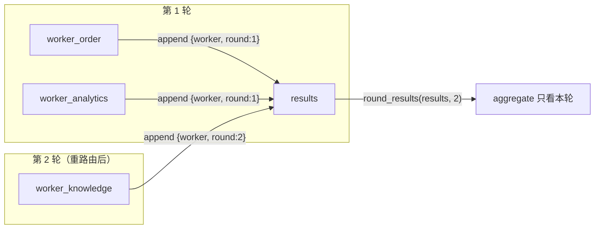
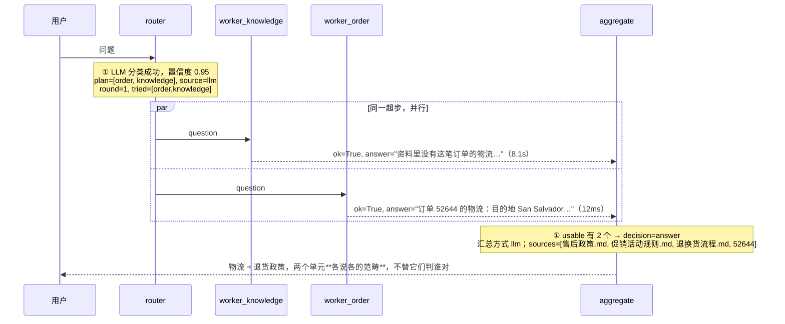
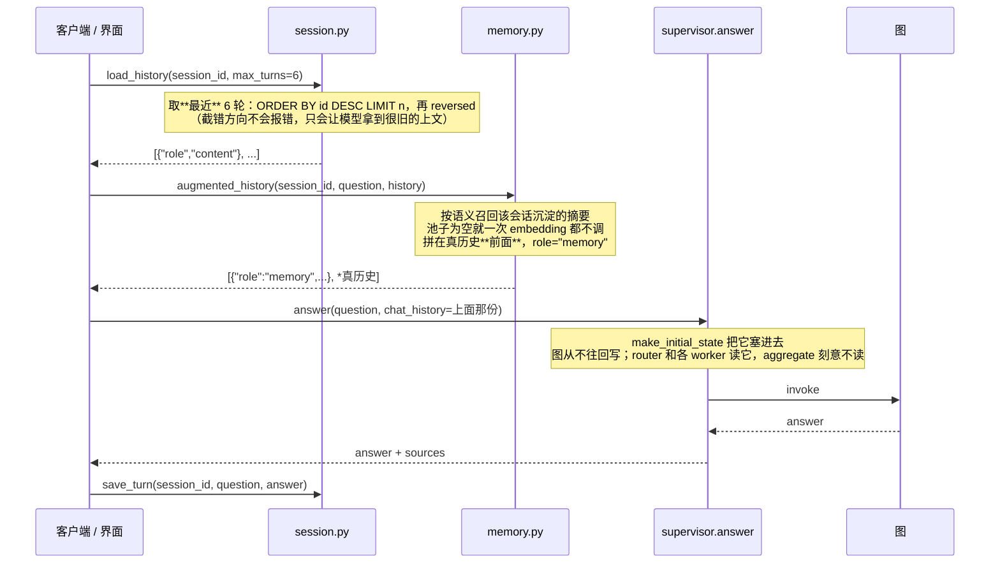
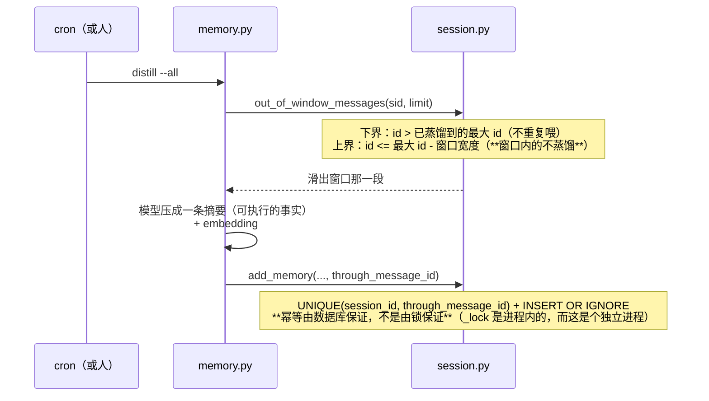
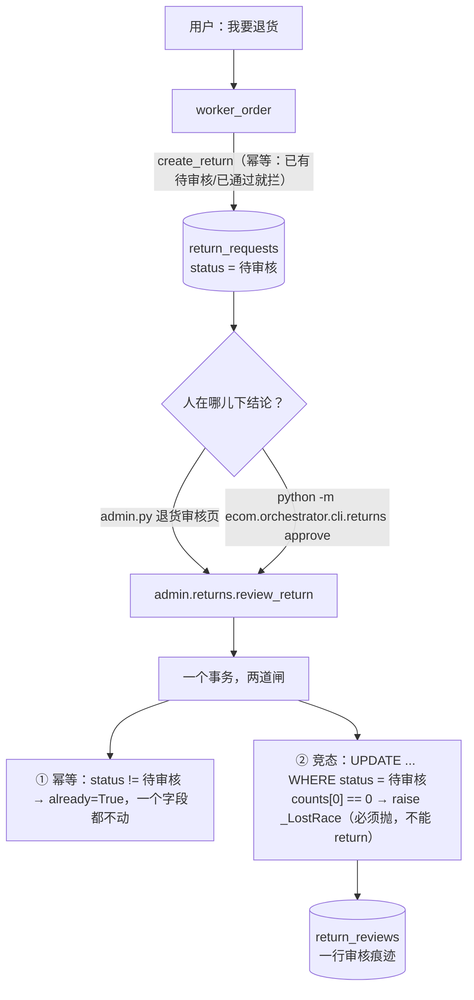

# 流程图

配着 [README.md](README.md) 看（要改代码的话再配 [docs/技术文档.md](docs/技术文档.md)）。这里只画**代码里真实存在的东西**：图的形状、状态怎么流、每个节点在哪一行。

---

## 一、图的形状

```mermaid
graph TD
    START((START)) --> router
    router -->|"superstep：三个节点同时进入<br>不在 plan 里的那个直接 return {}"| worker_knowledge
    router --> worker_order
    router --> worker_analytics
    worker_knowledge --> aggregate
    worker_order --> aggregate
    worker_analytics --> aggregate
    aggregate -->|'decision == "re_route"'| router
    aggregate -->|其它| END((END))
```

同一个东西，去掉渲染依赖：

```
                     ┌────────────────────────────────────┐
                     │            re_route                │
                     ▼                                    │
 START ──────► router ──┬──► worker_knowledge ──┐         │
                       ├──► worker_order     ──┼──► aggregate ──┬──► END
                       └──► worker_analytics ──┘               │
                                                               └──► END
```

**三条 worker 边永远都在，哪怕这次只用了一个。** 这不是疏漏，是取舍：条件边要动态决定连到谁，得用 LangGraph 的 `Send`（map-reduce），计划在 `router` 里已经算好了，把它摊成三条固定边 + 节点自己判空，换来的是一张**面试时能直接画在白板上**的图。代价是 trace 里会看到两个"没参与"的节点。见 [supervisor.py:14-25](ecom/orchestrator/core/supervisor.py#L14-L25)。

---

## 二、状态怎么流

`CSState`（[state.py](ecom/orchestrator/core/state.py)）里两个字段的走法要单独说，它们是多 agent 最容易被追问的地方。

### `results`：并行写 + 跨轮累加



`results: Annotated[list, operator.add]`——并行节点各自 append，合起来，谁也不覆盖谁。代价是**它跨轮只增不减**：往 add 型通道写 `[]` 等于没写。

所以每条结果由 `base.stamp_round` 盖上 `round` 标记，`aggregate` 用 `base.round_results` 挑出本轮的。**没有 reducer 的字段在并行写时 LangGraph 会直接报错**——那是保护，不是麻烦，它逼你想清楚"两个节点同时写同一个键"该合并还是该覆盖。

### `tried`：由 router 一次写入，worker 不碰

`tried` 也是"多个节点想写同一个键"的场合，但这里**没上 reducer**，改成由 `router` 一次性写入（[supervisor.py:63](ecom/orchestrator/core/supervisor.py#L63)）。理由：计划本来就是 router 定的，它顺手记下来最自然；而且这样绕开了并发写。**能用设计绕开的并发问题，就不该用锁或 reducer 去救。**

---

## 三、router 节点的三层优先级

代码在 [router.py:146-286](ecom/orchestrator/core/router.py#L146-L286)。顺序就是优先级，**从"聪明"到"兜底"**：

```
route(question, tried, chat_history)
  │
  ├─ ① LLM 分类          ── 成功 → source="llm"
  │     · 提示词里带一段**有界**的「上文」（最近 2 轮 + 几条记忆），
  │       否则「那能退吗」在分类器眼里是一句没主语的话
  │     └─ 失败（超时/没key/解析不出）→ 落到 ②
  │       · max_retries=0（重试权收回来）
  │       · ROUTER_TIMEOUT=8s 单次，ROUTER_BUDGET=20s 总时长
  │
  ├─ ② 关键词规则        ── 命中 → source="rule"
  │     订单号(5位以上数字)/物流/退货… → order
  │     销量/排名/趋势/占比…       → analytics
  │     政策/保修/发票/流程…       → knowledge
  │     · 另外：这句若是**指代上一轮的追问**（"那能退吗"），
  │       用 utils/entities.carried_order_id 携带回订单号 → 补一个 order
  │       （是"接着上一轮说"，**不是**往关键词表里加词）
  │     └─ 一个都没命中 → 落到 ③
  │
  └─ ③ 最小默认计划      ── source="fallback"，plan=["knowledge"]
        knowledge 是唯一"什么都能聊两句"的，答不出会走 insufficient
        （比甩一句"我帮您转人工"体验好）

  最后统一：plan = [n for n in plan if n not in tried]   ← 回环不原地打转
```

**`router_source` 必须记进 trace**：它是判断路由健康度的关键指标——"rule / fallback 的比例一涨，说明 LLM 那边在坏"。

低置信度（< 0.6）时会往计划里**补一个 knowledge**。这是**故意的不对称**：漏调一个 worker = 少答一半（用户看得出来），多调一个 = 多花一次调用（用户看不出来）。

**为什么路由也要看上一轮**：「那能退吗」「那它的金额是多少」这类追问，光看当轮那句字符串判断不了——它既没有订单号，也没有"订单"两个字。上一轮提到的那笔订单就是这句话的主语。所以 `route` 收一个 `chat_history`，**LLM 层**拿到一段有界的上文（最近 `_CONTEXT_TURNS=2` 轮，各截断到 160 字），**规则层**走 `carried_order_id`。

**门槛管的是"接着上一轮说"，不是"上一轮说过订单"**：没有指代词（那/它/这笔…）就不携带。少了这条，「退货政策是什么」会因为在订单问题后面出现而顺带带上 order——一个纯政策问题被拉去查订单，正是"往关键词表里加词做指代消解"的典型翻车。携带到的号**只读操作能用**（见 §四 与 [workers/order.py](ecom/orchestrator/workers/order.py) 开头的边界）。

---

## 四、aggregate 节点的决策树

代码在 [aggregate.py:176-258](ecom/orchestrator/core/aggregate.py#L176-L258)。**短路返回，顺序不能换**：

```
aggregate(state)
  │
  ├─ ① usable 非空 ──────────────────► decision = "answer"
  │      合并 usable；failed 的补一句"这块暂时用不了"；
  │      thin 的澄清话术、上一轮的 pending_note 都附在后面
  │
  ├─ ② 想重路由吗？ ─────────────────► decision = "re_route"
  │      can_retry = plan 非空          ← 空计划重来还是空
  │                & untried 非空       ← 没有新单元 = 原地打转
  │                & round < MAX_ROUNDS ← 回环有界
  │                & alive              ← 全挂了别换人再挂一次
  │
  ├─ ③ 手上有话可说吗？ ─────────────► decision = "answer"
  │      thin/failed 有话说 → 如实转达；
  │      全挂了的话再追加一句 HANDOFF
  │
  └─ ④ 什么都说不出来 ──────────────► decision = "human"
         HANDOFF_ONLY（唯一真正该转人工的情况）
```

两条最容易被问的：

- **`ok=False`（坏了）不触发重路由，`insufficient=True`（看过了没有）才触发。** 前者多半是同一个网络/同一台机器的问题，再试一次大概率还是坏——那叫"服务一抖动就换个 worker 再抖一次"。
- **`len(usable) == 1` 时不调模型**，原样返回。没有东西可合并时调模型，只会把一段本来忠实的话改写成可能不忠实的另一段话——多一次幻觉机会，零信息增益。

---

## 五、一次请求的完整时序

以 `订单 52644 到哪了，顺便问下你们的退货政策是什么` 为例，这是 **2026-10-11 真跑出来的一次**（模型和知识库都可用）：



整个过程：**第一次 invoke 就结束，没有回环**。两个 worker 的耗时差三个数量级（8.1 秒 vs 12 毫秒）——这就是为什么它们的超时是分开配的（90 / 20 / 180）。订单那一路走的是本地 SQLite + 纯规则，一次模型调用都没有；知识库那一路要向量化 + BM25 + rerank + 生成，四步都是网络往返。

此前一次 dashscope 不通的运行走的是另一条完整路径：**LLM 路由超时 8 秒 → 规则命中 → 知识库 worker 超时（ok=False）→ 订单那半照常答出来 → 明说"知识库这块暂时查不了"**，总耗时 17.6 秒而不是 180 秒。两条路径都不是摆拍，一次请求把三四条兜底链路全演示了。

---

## 六、三个子系统的调用边界

三个 worker 看起来都是"→ aggregate"的箭头，实际跑起来不一样：

```
worker_knowledge ──► 进程内 import      ecom.knowledge.retriever / generator / vector_store
                     │  (只 import 4 个入口，不 import core/graph.py：绕开联网搜索
                     │   + 待审核队列的副作用。这个理由和撞名无关，合并前后都成立)
                     │
worker_order     ──► 本进程 + SQLite    ecom/orchestrator/tools/order_tools.py（纯函数，无模型）
                     │
worker_analytics ──► subprocess        python -m ecom.analytics.cli.analyze "问题"
                     │  子进程 stdout 只吐一行 JSON；超时设成比 worker 超时短 5s，
                     │  让子进程自己的超时先触发（否则是父进程单方面放弃）
                     └─ PYTHONIOENCODING=utf-8（GBK 控制台）
```

**合并前这三行里有三处是为"跨仓库"写的**：知识库那条要 `sys.path.insert` 挂 sibling 仓库、还要一个 `_assert_imports_came_from()` 运行时闸门；数据分析那条的命令里写的是 `../sales_agent/analyze_json.py`，还要一个 `SALES_AGENT_PYTHON` 配置项来决定用哪个解释器。**现在都删了**：sibling 就是自己，子进程用 `sys.executable`（同一个 venv）。

**但数据分析那条边界留着**，理由换了一个：不再是被命名逼的，而是它执行的是模型生成的代码，需要一个能被真杀死的进程边界。完整版理由见 [workers/analytics.py](ecom/orchestrator/workers/analytics.py) 的模块 docstring。

**界面（`app.py`）也走这条边界**——它调的是同一个 `run_analytics()`，而不是"为了少起一个进程"直接 import 那个图。界面不该是那条边界的例外。

---

## 七、文件 → 节点

| 节点 | 文件 | 关键函数 |
|---|---|---|
| 图的装配 | [ecom/orchestrator/core/supervisor.py](ecom/orchestrator/core/supervisor.py) | `build_graph` / `_router_node` / `_worker_node` |
| 状态契约 | [ecom/orchestrator/core/state.py](ecom/orchestrator/core/state.py) | `CSState` / `WorkerResult` / `make_initial_state` |
| router | [ecom/orchestrator/core/router.py](ecom/orchestrator/core/router.py) | `route` / `_rule_route` / `parse_route` |
| aggregate | [ecom/orchestrator/core/aggregate.py](ecom/orchestrator/core/aggregate.py) | `aggregate` / `synthesize` / `_split` |
| worker 公共契约 | [ecom/orchestrator/workers/base.py](ecom/orchestrator/workers/base.py) | `run` / `ok_result` / `error_result` / `stamp_round` |
| 三个 worker | [ecom/orchestrator/workers/](ecom/orchestrator/workers/) | `knowledge.py` / `order.py` / `analytics.py` |
| 订单工具层 | [ecom/orchestrator/tools/order_tools.py](ecom/orchestrator/tools/order_tools.py) | 纯函数，`OrderNotFound` / `ReturnNotAllowed` |
| 订单库 | [ecom/orchestrator/db/](ecom/orchestrator/db/) | `engine.py`（双后端）/ `schema.sql` / `seed.py`（读种子）|
| 订单种子从哪来 | [ecom/orchestrator/db/derive_seed.py](ecom/orchestrator/db/derive_seed.py) | 一次性 ETL：公开数据集 → `data/orchestrator/seed/*.csv` |
| 知识库子系统 | [ecom/knowledge/](ecom/knowledge/) | `retriever` / `vector_store` / `embedding` / `generator` / `cli` |
| 数据分析子系统 | [ecom/analytics/](ecom/analytics/) | `core/graph.py` / `core/sandbox.py` / `agents/` / `cli/analyze.py` |

入口，各管一件事：

| 入口 | 给谁用 | 为什么是它 |
|---|---|---|
| [main.py](main.py) | **排查问题** | 决策链摊在眼前；界面会把它藏起来 |
| [app.py](app.py) | 演示 | 主区是对话，另外三个面收在侧边栏；四个视图共用一份进程 |
| [admin.py](admin.py) | **下结论 + 接人工** | 口令模式三个页面；身份层模式多一个客服工作台，按角色渲染；口令不配就拒绝启动 |
| [api.py](api.py) | 被别的程序调 | `def` 不是 `async def`——图里全是阻塞调用 |
| `python -m ecom.analytics.cli.analyze` | **给编排层当子进程** | stdout 只吐一行 JSON；契约写在名字里 |
| `python -m ecom.orchestrator.cli.returns` | 容器里排障 / 写脚本 | 和 `admin.py` 调**同一份** `admin.returns`，不是两套逻辑 |
| `python -m ecom.orchestrator.cli.session` | 会话的 list / show / delete / purge | 长驻进程不自清，清理由这条命令承担 |
| `python -m ecom.orchestrator.cli.memory` | 记忆的 distill / list / recall | 蒸馏要调模型，**刻意不放在问答路径上**（见第八节后半） |

`admin.py` 和 `app.py` **并列而不是合成一个**：`app.py` 是"面向客户、clone 下来点开就能用"，加一个密码框会毁掉这个定位。客服工作台同时存在于 React 弹窗和 `admin.py`，两边调的是**同一个** `orchestrator/tickets.py`。

---

## 八、会话是怎么进出的

`chat_history` 在 supervisor 里是**节点输入**，不是图状态——这一条决定了它**不能**交给 `SqliteSaver`（理由见 README「会话持久化」）。



**注入在调用方做，图里没有"记忆"这个字段**——省下十几个文件的改动不是主要理由，
**多一条要与 `chat_history` 长期保持同步的平行管道才是**。代价是调用方得守一条规矩：
**每轮现拼、不落盘、不累积**（拿到返回值直接传给 `answer()`，不要再存回去）。
记忆不进 `messages` 表，所以它不会出现在 `cli.session show` 里，也不会被 `history()` 截断。

三个旋钮分开：`HISTORY_TURNS=6` 管**成本**（喂多少原文），`SESSION_TTL_DAYS=30` 管**合规**（留多久），`MEMORY_TOP_K=3` 管**成本**（带几条摘要）——但后两者是**两条独立的通道**（原文精确但贵，摘要便宜但有损），不给它们一个共同的倍率。合并成一个开关，会在有人想省钱的时候顺手把合规期限也改掉。

### 八之二、记忆是**离线**长出来的



**为什么不顺手在问答路径上蒸**：那意味着用户每问一句都可能多一次模型调用，而且不可控
（第一次问就触发全量蒸馏）。收成显式命令之后，模型调用只在有人敲它的时候发生。
**代价说清：记忆不是实时的** —— 要有人跑 `distill` 才更新，所以它也要外挂 cron，
和 `purge` 同一个立场。

**`session_id` 是凭证不是账号**（客户身份是 `_guess_customer` 从话里猜的、未认证的），所以界面不把它放进 URL、只显示前 12 位。这条"没做的能力"由测试钉着。

---

## 九、退货审核这一环

模型那条路**只能登记，不能拍板**；结论由人在 `admin.py` 或 CLI 下。两条路调的是同一个 `review_return`。



两个方向相反的拦截条件，**必须各写一条测试**，只写一条的话另一种写法照样全绿：

- **`已通过` 必须拦**重复申请——漏了它，同一笔订单能再申请一次，**结果是两笔退款**，而且看起来一切正常。
- **`已拒绝` 必须放**——拦了它，用户会撞上"你被拒绝过所以永远不能再申请"，而界面上没有任何一句话说明这件事。

**幂等**的语义和知识库队列那边「人工定了就不再回退」是同一个：人的结论是**证据**，不是可以被后一次点击改写的草稿。

**"批准"的边界写死**：改 `status` + 插痕迹（一个事务）；**不执行退款**（没有支付网关，假装退款比不做更坏）；**不改 `orders.status`**（那是数据源原值，改它就是编造数据）。

**目录即边界**：`ecom/orchestrator/tools/` 是**模型能调到的**，`ecom/orchestrator/admin/` 是**只有人能下的结论**。把 `review_return` 放进 `order_tools.py`，等于把"模型可以拍板"写进架构里——哪怕现在没有任何工具去调它。
