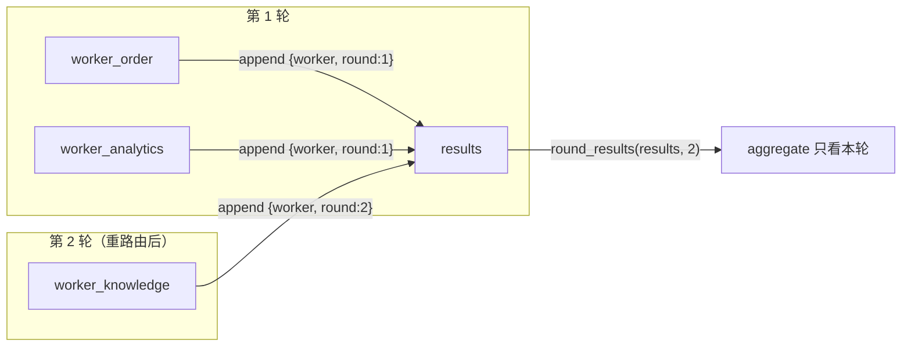
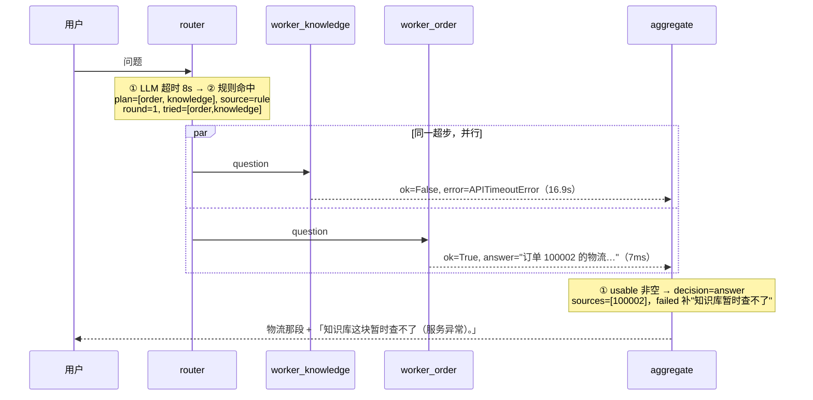

# 流程图

配着 [README.md](README.md) 看。这里只画**代码里真实存在的东西**：图的形状、状态怎么流、每个节点在哪一行。

---

## 一、图的形状

```mermaid
graph TD
    START((START)) --> router
    router -->|"superstep：三个节点同时进入<br>不在 plan 里的那个直接 return {}"| worker_knowledge
    router --> worker_order
    router --> worker_analytics
    worker_knowledge --> aggregate
    worker_order --> aggregate
    worker_analytics --> aggregate
    aggregate -->|'decision == "re_route"'| router
    aggregate -->|其它| END((END))
```

同一个东西，去掉渲染依赖：

```
                     ┌────────────────────────────────────┐
                     │            re_route                │
                     ▼                                    │
 START ──────► router ──┬──► worker_knowledge ──┐         │
                       ├──► worker_order     ──┼──► aggregate ──┬──► END
                       └──► worker_analytics ──┘               │
                                                               └──► END
```

**三条 worker 边永远都在，哪怕这次只用了一个。** 这不是疏漏，是取舍：条件边要动态决定连到谁，得用 LangGraph 的 `Send`（map-reduce），计划在 `router` 里已经算好了，把它摊成三条固定边 + 节点自己判空，换来的是一张**面试时能直接画在白板上**的图。代价是 trace 里会看到两个"没参与"的节点。见 [supervisor.py:14-25](cs/core/supervisor.py#L14-L25)。

---

## 二、状态怎么流

`CSState`（[state.py](cs/core/state.py)）里两个字段的走法要单独说，它们是多 agent 最容易被追问的地方。

### `results`：并行写 + 跨轮累加



`results: Annotated[list, operator.add]`——并行节点各自 append，合起来，谁也不覆盖谁。代价是**它跨轮只增不减**：往 add 型通道写 `[]` 等于没写。

所以每条结果由 `base.stamp_round` 盖上 `round` 标记，`aggregate` 用 `base.round_results` 挑出本轮的。**没有 reducer 的字段在并行写时 LangGraph 会直接报错**——那是保护，不是麻烦，它逼你想清楚"两个节点同时写同一个键"该合并还是该覆盖。

### `tried`：由 router 一次写入，worker 不碰

`tried` 也是"多个节点想写同一个键"的场合，但这里**没上 reducer**，改成由 `router` 一次性写入（[supervisor.py:63](cs/core/supervisor.py#L63)）。理由：计划本来就是 router 定的，它顺手记下来最自然；而且这样绕开了并发写。**能用设计绕开的并发问题，就不该用锁或 reducer 去救。**

---

## 三、router 节点的三层优先级

代码在 [router.py:137-210](cs/core/router.py#L137-L210)。顺序就是优先级，**从"聪明"到"兜底"**：

```
route(question, tried)
  │
  ├─ ① LLM 分类          ── 成功 → source="llm"
  │     └─ 失败（超时/没key/解析不出）→ 落到 ②
  │       · max_retries=0（重试权收回来）
  │       · ROUTER_TIMEOUT=8s 单次，ROUTER_BUDGET=20s 总时长
  │
  ├─ ② 关键词规则        ── 命中 → source="rule"
  │     订单号(6位数字)/物流/退货… → order
  │     销量/排名/趋势/占比…       → analytics
  │     政策/保修/发票/流程…       → knowledge
  │     └─ 一个都没命中 → 落到 ③
  │
  └─ ③ 最小默认计划      ── source="fallback"，plan=["knowledge"]
        knowledge 是唯一"什么都能聊两句"的，答不出会走 insufficient
        （比甩一句"我帮您转人工"体验好）

  最后统一：plan = [n for n in plan if n not in tried]   ← 回环不原地打转
```

**`router_source` 必须记进 trace**：它是判断路由健康度的关键指标——"rule / fallback 的比例一涨，说明 LLM 那边在坏"。

低置信度（< 0.6）时会往计划里**补一个 knowledge**。这是**故意的不对称**：漏调一个 worker = 少答一半（用户看得出来），多调一个 = 多花一次调用（用户看不出来）。

---

## 四、aggregate 节点的决策树

代码在 [aggregate.py:176-258](cs/core/aggregate.py#L176-L258)。**短路返回，顺序不能换**：

```
aggregate(state)
  │
  ├─ ① usable 非空 ──────────────────► decision = "answer"
  │      合并 usable；failed 的补一句"这块暂时用不了"；
  │      thin 的澄清话术、上一轮的 pending_note 都附在后面
  │
  ├─ ② 想重路由吗？ ─────────────────► decision = "re_route"
  │      can_retry = plan 非空          ← 空计划重来还是空
  │                & untried 非空       ← 没有新单元 = 原地打转
  │                & round < MAX_ROUNDS ← 回环有界
  │                & alive              ← 全挂了别换人再挂一次
  │
  ├─ ③ 手上有话可说吗？ ─────────────► decision = "answer"
  │      thin/failed 有话说 → 如实转达；
  │      全挂了的话再追加一句 HANDOFF
  │
  └─ ④ 什么都说不出来 ──────────────► decision = "human"
         HANDOFF_ONLY（唯一真正该转人工的情况）
```

两条最容易被问的：

- **`ok=False`（坏了）不触发重路由，`insufficient=True`（看过了没有）才触发。** 前者多半是同一个网络/同一台机器的问题，再试一次大概率还是坏——那叫"服务一抖动就换个 worker 再抖一次"。
- **`len(usable) == 1` 时不调模型**，原样返回。没有东西可合并时调模型，只会把一段本来忠实的话改写成可能不忠实的另一段话——多一次幻觉机会，零信息增益。

---

## 五、一次请求的完整时序

以 `订单 100002 到哪了，顺便问下你们的退货政策是什么` 为例（**模型和知识库都不可用时**的真实走向）：



整个过程：**第一次 invoke 就结束，没有回环**。模型挂了走规则（~25s，不是 180s），一个 worker 挂了用其余的答，并且**明说哪块没拿到**——不假装全都查到了。

---

## 六、跨仓库的调用边界

三个 worker 有**两种**接入方式，图上看起来都是"→ aggregate"的箭头，实际跑起来不一样：

```
worker_knowledge ──► 进程内 import      rag.src.retriever / generator / vector_store
                     │  (只 import 4 个入口，不 import graph.py：绕开联网搜索 + 待审核队列副作用)
                     │  · 启动时 _assert_imports_came_from() 检查 __file__ 是否真在 rag 下
                     │
worker_order     ──► 本进程 + SQLite    cs/tools/order_tools.py（纯函数，无模型）
                     │
worker_analytics ──► subprocess        python ../sales_agent/analyze_json.py "问题"
                     │  子进程 stdout 只吐一行 JSON；超时设成比 worker 超时短 5s，
                     │  让子进程自己的超时先触发（否则是父进程单方面放弃）
                     └─ PYTHONIOENCODING=utf-8（GBK 控制台）
```

为什么知识库是进程内、数据分析是子进程，见 [README.md](README.md#三个-worker两种接入方式)——一句话：知识库是热路径且无副作用（省一次进程启动），数据分析是唯一执行模型生成代码的（需要真进程边界才能真杀）。

---

## 七、文件 → 节点

| 节点 | 文件 | 关键函数 |
|---|---|---|
| 图的装配 | [cs/core/supervisor.py](cs/core/supervisor.py) | `build_graph` / `_router_node` / `_worker_node` |
| 状态契约 | [cs/core/state.py](cs/core/state.py) | `CSState` / `WorkerResult` / `make_initial_state` |
| router | [cs/core/router.py](cs/core/router.py) | `route` / `_rule_route` / `parse_route` |
| aggregate | [cs/core/aggregate.py](cs/core/aggregate.py) | `aggregate` / `synthesize` / `_split` |
| worker 公共契约 | [cs/workers/base.py](cs/workers/base.py) | `run` / `ok_result` / `error_result` / `stamp_round` |
| 三个 worker | [cs/workers/](cs/workers/) | `knowledge.py` / `order.py` / `analytics.py` |
| 订单工具层 | [cs/tools/order_tools.py](cs/tools/order_tools.py) | 纯函数，`OrderNotFound` / `ReturnNotAllowed` |
| 订单库 | [cs/db/](cs/db/) | `engine.py`（双后端）/ `schema.sql` / `seed.py` |
| 入口 | [main.py](main.py) / [api.py](api.py) | CLI / FastAPI |
